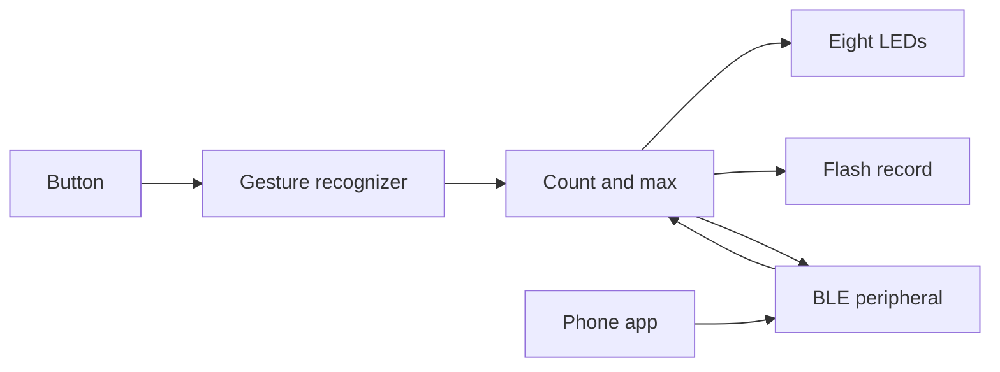

# Charge Counter

A small rechargeable counter. One button, eight LEDs, and a number from 0 to a per-device maximum that survives power loss. A phone app talks to any number of these devices over Bluetooth Low Energy and can read each count or set each device's maximum.

The behavior, wiring, radio contract, and power policy are specified. The firmware builds around those contracts. Gesture recognition, the LED pattern, flash storage, BLE, sleep, and the phone app are tracked as GitHub issues and are not implemented yet.

## What the button does

| Gesture | Result |
| --- | --- |
| Single press | Show the current number on the LEDs, then turn them off. The number does not change. |
| Double press | Subtract one. Further presses in the same rhythm subtract one more each. |
| Long press | Add one when the hold crosses the long-press time, then keep adding while the hold continues. |
| Hold on after the count reaches max | Three more seconds opens pairing. All eight lamps blink blue, and a phone can bond. |

The number stays inside 0 and the device's max. Max is an integer from 1 to 16, stored on the device, defaulting to 2, and changed from the phone. The full timing and edge cases are in [docs/behavior.md](docs/behavior.md).

The eight RGB lamps count one step at a time. The first pass is red: one lamp is 1, eight lamps is 8. The second pass turns those lamps green, so 9 is one green lamp and seven red, and 16 is all green. Each reading starts with a short blue flash of all eight, so a count of zero is visible and then goes dark. Blue is also the pairing blink and the locate chase.

## How the pieces fit

The phone is a central. Each device is its own peripheral with its own count, max, and name. The app lists the counters that phone has bonded, and, on the add screen, counters that are in the pairing window. A counter that is neither bonded nor pairing is not shown. The app shows the latest count and writes a new max or name to a bonded device only. Bonding takes a hold until the count is at max, then three more seconds, with no cable. Another person's phone cannot read or change a counter it has not bonded. Locate makes that one counter chase its eight lamps in blue so it can be picked out of a group.

## Repository

| Path | Contents |
| --- | --- |
| [docs/behavior.md](docs/behavior.md) | Button state machine, LED encoding, flash record |
| [docs/hardware.md](docs/hardware.md) | Custom PCB, charging, and assembly rules |
| [hardware/bom.csv](hardware/bom.csv) | JLCPCB part numbers |
| [docs/ble.md](docs/ble.md) | Advertising and GATT contract |
| [docs/power.md](docs/power.md) | Sleep and battery-life policy |
| [firmware/](firmware/) | PlatformIO project for the nRF52832 module |
| [app/](app/) | Phone app contract |

The board is a custom two-layer PCB built around an Ebyte E73-2G4M04S1B (nRF52832). Firmware loads over USB-C through a CH340C that is only powered while the cable is plugged in. JLCPCB Economic assembly places one side. The USB-C socket and the button are hand soldered. The machine-placed extended parts are the module, the charger, the CH340C, and the eight addressable lamps (one feeder).

## Firmware status

| Module | What is in the tree |
| --- | --- |
| `main.cpp` | Connects gestures, storage, LEDs, BLE, and sleep |
| `counter_store` | RAM clamping for add, subtract, and set-max |
| `button_gestures` | View, subtract chain, hold-to-add, hold-at-max pairing |
| `led_display` | Count lamps are driven off. The red-then-green pattern is unimplemented |
| `ble_link` | Callback slot only. Radio is unimplemented |
| `power_mgmt` | Yields the CPU. Sleep is unimplemented |

Flashing this tree recognizes button gestures. The lamps stay off, nothing is advertised, and flash is not written yet. Build instructions are in [firmware/README.md](firmware/README.md).

## Work remaining

| Issue | Feature |
| --- | --- |
| [#1](https://github.com/FixerSchis/charge-counter/issues/1) | Custom PCB laid out for cheap SMT assembly |
| [#3](https://github.com/FixerSchis/charge-counter/issues/3) | Count and max kept across power loss |
| [#4](https://github.com/FixerSchis/charge-counter/issues/4) | Red-then-green count on the eight RGB lamps |
| [#5](https://github.com/FixerSchis/charge-counter/issues/5) | BLE advertising, count, max, and battery |
| [#6](https://github.com/FixerSchis/charge-counter/issues/6) | Sleep, and a measured battery life |
| [#7](https://github.com/FixerSchis/charge-counter/issues/7) | Phone app that monitors several devices |
| [#8](https://github.com/FixerSchis/charge-counter/issues/8) | Per-device max edited from the phone |

## License

[MIT](LICENSE).
