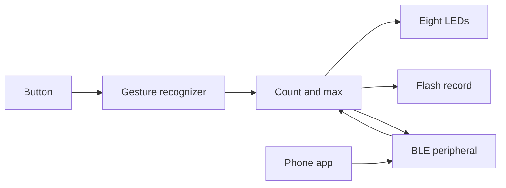

# Charge Counter

A small rechargeable counter. One button, eight LEDs, and a number from 0 to a per-device maximum that survives power loss. A phone app talks to any number of these devices over Bluetooth Low Energy and can read each count or set each device's maximum.

The behavior, wiring, radio contract, and power policy are specified. The firmware builds around those contracts. Gesture recognition, the LED pattern, flash storage, BLE, sleep, and the phone app are tracked as GitHub issues and are not implemented yet.

## What the button does

| Gesture | Result |
| --- | --- |
| Single press | Show the current number on the LEDs, then turn them off. The number does not change. |
| Double press | Subtract one. Further presses in the same rhythm subtract one more each. |
| Long press | Add one when the hold crosses the long-press time, then keep adding while the hold continues. |

The number stays inside 0 and the device's max. Max is an integer from 1 to 255, stored on the device, and changed from the phone. The full timing and edge cases are in [docs/behavior.md](docs/behavior.md).

The eight LEDs show the number in binary, least significant bit on P0.02. Each reading starts with a short flash of all eight, so a count of zero is visible and then goes dark.

## How the pieces fit

The phone is a central. Each device is its own peripheral with its own count and max. The app lists every device it has seen, shows the latest count, and writes a new max to that device only.

## Repository

| Path | Contents |
| --- | --- |
| [docs/behavior.md](docs/behavior.md) | Button state machine, LED encoding, flash record |
| [docs/hardware.md](docs/hardware.md) | Custom PCB, charging, and assembly rules |
| [hardware/bom.csv](hardware/bom.csv) | JLCPCB part numbers |
| [docs/ble.md](docs/ble.md) | Advertising and GATT contract |
| [docs/power.md](docs/power.md) | Sleep and battery-life policy |
| [firmware/](firmware/) | PlatformIO project for the nRF52832 module |
| [app/](app/) | Phone app contract |

The board is a custom two-layer PCB built around an Ebyte E73-2G4M04S1B (nRF52832). Firmware loads over USB-C through a CH340C that is only powered while the cable is plugged in. JLCPCB Economic assembly places one side. The USB-C socket and the button are hand soldered. The machine-placed extended parts are the module, the charger, and the CH340C.

## Firmware status

| Module | What is in the tree |
| --- | --- |
| `main.cpp` | Connects gestures, storage, LEDs, BLE, and sleep |
| `counter_store` | RAM clamping for add, subtract, and set-max |
| `button_gestures` | Button pin is an input pull-up. Recognition is unimplemented |
| `led_display` | Count LEDs are driven off. Binary pattern is unimplemented |
| `ble_link` | Callback slot only. Radio is unimplemented |
| `power_mgmt` | Yields the CPU. Sleep is unimplemented |

Flashing this tree produces a quiet board: LEDs off, button ignored, no advertising. Build instructions are in [firmware/README.md](firmware/README.md).

## Work remaining

| Issue | Feature |
| --- | --- |
| [#1](https://github.com/FixerSchis/charge-counter/issues/1) | Custom PCB laid out for cheap SMT assembly |
| [#2](https://github.com/FixerSchis/charge-counter/issues/2) | Single-press view, double-press subtract, hold-to-add |
| [#3](https://github.com/FixerSchis/charge-counter/issues/3) | Count and max kept across power loss |
| [#4](https://github.com/FixerSchis/charge-counter/issues/4) | Binary display on the eight LEDs |
| [#5](https://github.com/FixerSchis/charge-counter/issues/5) | BLE advertising, count, max, and battery |
| [#6](https://github.com/FixerSchis/charge-counter/issues/6) | Sleep, and a measured battery life |
| [#7](https://github.com/FixerSchis/charge-counter/issues/7) | Phone app that monitors several devices |
| [#8](https://github.com/FixerSchis/charge-counter/issues/8) | Per-device max edited from the phone |

## License

[MIT](LICENSE).
