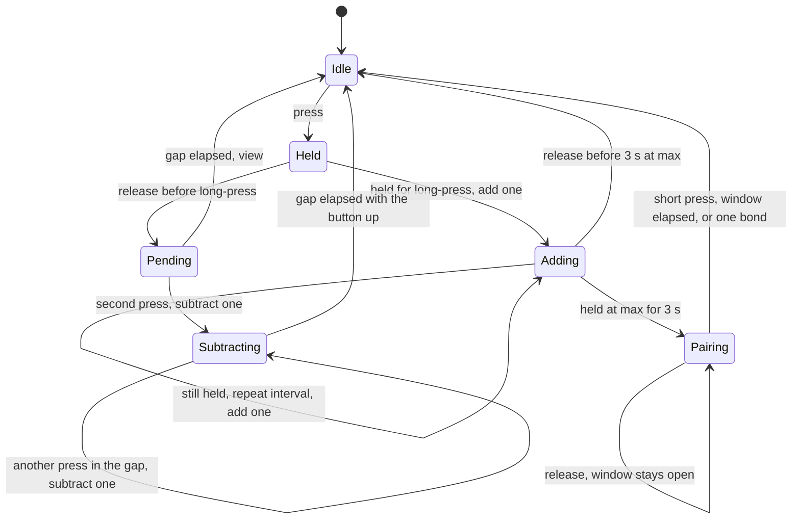

# Button, LEDs, and stored number

This is the contract for the gesture recognizer, the LED module, and the flash record. Timing constants live in `firmware/src/config.h`.

## Stored number

Each device stores two integers:

| Field | Range | Default |
| --- | --- | --- |
| count | 0 .. max | 0 |
| max | 1 .. 16 | 2 |

Add stops at max. Subtract stops at 0. A new max below the current count clamps the count down to that max. The phone is told about both changes. Setting max does not light the LEDs unless a reading is already on the display, in which case the LEDs refresh to the clamped count.

The device is the source of truth. The phone caches the last value it saw so the list is useful out of range.

## Gestures

One momentary button, active low.

A press shorter than `LONG_PRESS_MS` (600 ms) is a short press. The recognizer waits `PRESS_GAP_MS` (400 ms) after that press is released before deciding what it was.

| Input | Effect |
| --- | --- |
| One short press, and no second press before the gap closes | View. Light the LEDs. Count is unchanged. |
| A second short press before the gap closes | Subtract one. This is the double-press. |
| Another short press before the gap closes again | Subtract one more. The third press, the fourth press, and so on each subtract one. |
| Hold from idle for `LONG_PRESS_MS` | Add one at that moment. |
| Keep holding | Add one every `ADD_REPEAT_MS` (400 ms) until release or max. |
| Keep holding after the count is already max | For `PAIR_AT_MAX_MS` (3 s) more, then pairing. The count stays at max. |

The LEDs stay dark until a view is committed or a count change happens. A double-press therefore does not flash the old number first. A view appears about one gap time after the finger lifts, which is how a single press stays distinct from a double press.

A hold that starts as part of a subtract chain does not add. The subtract already happened when that press went down. Adding only starts from an idle hold that reaches the long-press time.

Pairing is that same idle hold, continued. The three seconds start when the count reaches max during the hold. If the count is already max, they start at the accepted press. Releasing before the three seconds elapse leaves the count where the adds put it and does not open pairing. A short press while the count is max is still only a view. When the three seconds elapse, the hold stops adding, all eight lamps blink blue together, and the bonding window in [docs/ble.md](ble.md) opens. Releasing after that does not cancel the window.

While those LEDs are flashing, a short press cancels pairing and leaves bonds unchanged. A hold of `PAIR_FORGET_MS` (3 s) forgets every bonded phone and leaves the window open. The hold that opened the window does not count as that second hold; the finger has to lift first.

Edges use a `DEBOUNCE_MS` (25 ms) stable reading. Long-press time is measured from the accepted press. The gap is measured from the accepted release to the next accepted press.

`ButtonGestures::isBusy()` is true from the press that opens a gesture until that gesture is classified and any subtract chain has finished, including the quiet gap waiting for another tap. It is false only in idle. After `poll()` returns, `isBusy()` describes the state that follows the event:

| Event just returned | `isBusy()` afterwards |
| --- | --- |
| `View` | false |
| `SubtractOne` | true |
| `AddOne` | true, until the button is released and the following poll reports idle |
| `None` while a gap is open | true |
| `None` while idle | false |

The firmware flushes flash when a gesture goes from busy to idle, so a long hold does not rewrite flash on every added step. A power loss during the hold keeps the last flushed count.

## LED encoding

Eight addressable RGB lamps, in a fixed order. The first lamp is the first pixel in the chain. Wiring is in [docs/hardware.md](hardware.md). Counting is one lamp per step, not binary.

The first pass lights lamps red. One red lamp is 1, two red lamps are 2, and all eight red is 8. The second pass turns those same lamps green, starting again at the first lamp. A count of 9 is the first lamp green and the other seven red. A count of 16 is all eight green. That is the top of the display, and the highest max the device will store.

| Count | Lamps, after the opening flash |
| --- | --- |
| 0 | All off |
| 1 | First lamp red |
| 5 | First five lamps red |
| 8 | All eight red |
| 9 | First lamp green, other seven red |
| 16 | All eight green |

Every reading starts with all eight lamps blue for `ACK_FLASH_MS` (150 ms), then the red and green pattern for the rest of the display time. That flash is how a count of zero is visible: the lamps blink blue, then stay dark. Asleep, before any reading, the lamps never flash.

Blue is status. Pairing blinks all eight blue together, on and off, until the window ends. Locate (detect) lights one lamp blue at a time, first through eighth, for `LOCATE_STEP_MS` (150 ms) each, and repeats that chase `LOCATE_CYCLES` (4) times. Neither pattern is cut short by `DISPLAY_MS`. A locate chase that starts during an open pairing window gives the window its blue blink back when the chase finishes. Other color mixes are reserved for later modes and are not used yet.

The charge LED is the separate red lamp driven by the charger from USB power. It is not one of these eight.

The reading stays up for `DISPLAY_MS` (2500 ms) after the last view or count change, measured from the start of the flash, then every count lamp turns off. A gesture that is still busy holds the reading past that timeout. Each new add or subtract restarts the flash and the 2500 ms.

A later version can let the phone choose which pixel is first, second, and so on. That is a stored order, not a wiring change. This version uses the chain order above.

## Scenarios

| # | Action | Count before | Count after | Display |
| --- | --- | --- | --- | --- |
| 1 | Short press, then wait out the gap | 5 | 5 | Five red lamps, then off |
| 2 | Two presses inside the gap | 5 | 4 | Four red lamps, then off |
| 3 | Two presses, then a third inside the next gap | 5 | 3 | Three red lamps, then off |
| 4 | Hold past the long-press time and release | 5 | 6 | Six red lamps from the moment of the add |
| 5 | Keep holding | 6 | 7, then 8, until max | Updates on each add |
| 6 | Subtract at 0 | 0 | 0 | All eight flash blue, then dark |
| 7 | Add at max | max | max | The pattern for that max |
| 8 | Remove power and restore it | 4 | 4 | Dark until the next view |

Scenarios 1–7 are the gesture and LED work. Scenario 8 is the flash work. Hitting the floor or the ceiling still refreshes the display and does not send a BLE notification, because the value did not change.

## Persistence

`CounterStore` applies the range rules in RAM. `begin()` loads the record, or the defaults when no valid record exists. `commit()` writes only when the record is dirty.

The file is `/counter.bin` on the board's internal filesystem. Bytes are little-endian:

| Offset | Size | Contents |
| --- | --- | --- |
| 0 | 4 | ASCII `CC02` |
| 4 | 2 | count |
| 6 | 2 | max |
| 8 | 1 | name length, 0 to 32 |
| 9 | 32 | name, UTF-8, unused bytes zero |
| 41 | 2 | CRC-16/CCITT-FALSE over the first 41 bytes (poly 0x1021, init 0xFFFF) |

A missing file or a bad magic or CRC loads count 0, max 2, and an empty name, and rewrites the file on the next commit. Flash writes have to be safe while the SoftDevice is running. The name is the label from the phone in [docs/ble.md](ble.md).

## State machine

