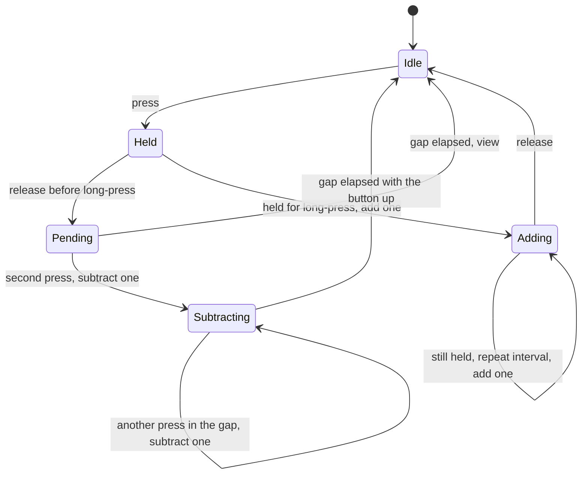

# Button, LEDs, and stored number

This is the contract for the gesture recognizer, the LED module, and the flash record. Timing constants live in `firmware/src/config.h`.

## Stored number

Each device stores two integers:

| Field | Range | Default |
| --- | --- | --- |
| count | 0 .. max | 0 |
| max | 1 .. 255 | 8 |

Add stops at max. Subtract stops at 0. A new max below the current count clamps the count down to that max. The phone is told about both changes. Setting max does not light the LEDs unless a reading is already on the display, in which case the LEDs refresh to the clamped count.

The device is the source of truth. The phone caches the last value it saw so the list is useful out of range.

## Gestures

One momentary button, active low.

A press shorter than `LONG_PRESS_MS` (600 ms) is a short press. The recognizer waits `PRESS_GAP_MS` (400 ms) after that press is released before deciding what it was.

| Input | Effect |
| --- | --- |
| One short press, and no second press before the gap closes | View. Light the LEDs. Count is unchanged. |
| A second short press before the gap closes | Subtract one. This is the double-press. |
| Another short press before the gap closes again | Subtract one more. The third press, the fourth press, and so on each subtract one. |
| Hold from idle for `LONG_PRESS_MS` | Add one at that moment. |
| Keep holding | Add one every `ADD_REPEAT_MS` (400 ms) until release or max. |

The LEDs stay dark until a view is committed or a count change happens. A double-press therefore does not flash the old number first. A view appears about one gap time after the finger lifts, which is how a single press stays distinct from a double press.

A hold that starts as part of a subtract chain does not add. The subtract already happened when that press went down. Adding only starts from an idle hold that reaches the long-press time.

Edges use a `DEBOUNCE_MS` (25 ms) stable reading. Long-press time is measured from the accepted press. The gap is measured from the accepted release to the next accepted press.

`ButtonGestures::isBusy()` is true from the press that opens a gesture until that gesture is classified and any subtract chain has finished, including the quiet gap waiting for another tap. It is false only in idle. After `poll()` returns, `isBusy()` describes the state that follows the event:

| Event just returned | `isBusy()` afterwards |
| --- | --- |
| `View` | false |
| `SubtractOne` | true |
| `AddOne` | true, until the button is released and the following poll reports idle |
| `None` while a gap is open | true |
| `None` while idle | false |

The firmware flushes flash when a gesture goes from busy to idle, so a long hold does not rewrite flash on every added step. A power loss during the hold keeps the last flushed count.

## LED encoding

External LEDs are wired active high. D0 is bit 0 (value 1). D7 is bit 7 (value 128).

| Count | LEDs |
| --- | --- |
| 0 | D0–D7 off |
| 1 | D0 |
| 5 | D0 and D2 |
| 255 | D0–D7 |

The onboard green LED (`LED_GREEN` on the Adafruit core, pin 13, P0.30) is the "reading is visible" lamp. It follows `LED_STATE_ON` from the board package. It is lit for every reading, including zero, and it is off when the display is asleep. Asleep and "showing zero" are different.

The reading stays up for `DISPLAY_MS` (2500 ms) after the last view or count change, then every LED turns off. A gesture that is still busy holds the reading past that timeout. Each new add or subtract restarts the 2500 ms.

## Scenarios

| # | Action | Count before | Count after | Display |
| --- | --- | --- | --- | --- |
| 1 | Short press, then wait out the gap | 5 | 5 | Binary 5, then off |
| 2 | Two presses inside the gap | 5 | 4 | Binary 4, then off |
| 3 | Two presses, then a third inside the next gap | 5 | 3 | Binary 3, then off |
| 4 | Hold past the long-press time and release | 5 | 6 | Binary 6 from the moment of the add |
| 5 | Keep holding | 6 | 7, then 8, until max | Updates on each add |
| 6 | Subtract at 0 | 0 | 0 | Green LED only |
| 7 | Add at max | max | max | Binary max |
| 8 | Remove power and restore it | 4 | 4 | Dark until the next view |

Scenarios 1–7 are the gesture and LED work. Scenario 8 is the flash work. Hitting the floor or the ceiling still refreshes the display and does not send a BLE notification, because the value did not change.

## Persistence

`CounterStore` applies the range rules in RAM. `begin()` loads the record, or the defaults when no valid record exists. `commit()` writes only when the record is dirty.

The file is `/counter.bin` on the board's internal filesystem. Bytes are little-endian:

| Offset | Size | Contents |
| --- | --- | --- |
| 0 | 4 | ASCII `CC01` |
| 4 | 2 | count |
| 6 | 2 | max |
| 8 | 2 | CRC-16/CCITT-FALSE over the first 8 bytes (poly 0x1021, init 0xFFFF) |

A missing file or a bad magic or CRC loads count 0 and max 8 and rewrites the file on the next commit. Flash writes have to be safe while the SoftDevice is running.

## State machine

